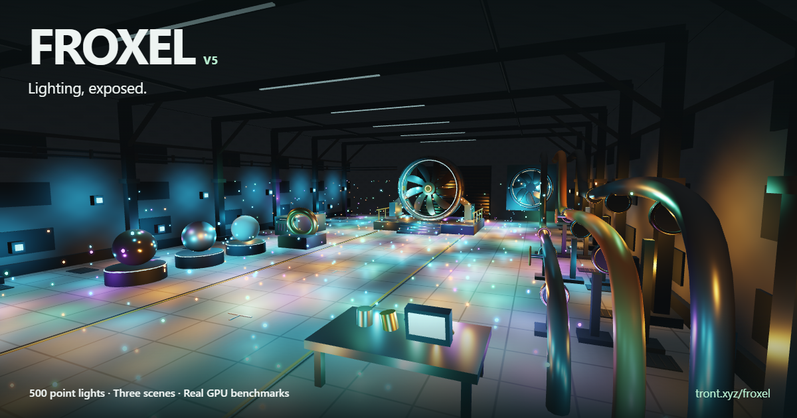

# Froxel

**Lighting, exposed.** A point-light playground with three environments, real GPU light-list inspection, and a benchmark you can run on your own hardware.

[Open the demo](https://tront.xyz/froxel/) · [Trent Sterling](https://tront.xyz/)



## V5

V5 gives the V3 lighting renderer a new HTML interface: keyboard-accessible controls, a collapsible inspector, a responsive lighting dock, touch look/tap gestures, and an on-demand benchmark workspace. The page opens directly into the scene.

- **Play:** Industrial hall, material studio, and courtyard. Throw, paint, or grab lights; adjust count, range, fog, and camera movement.
- **Explain:** Select a surface and inspect its material, normals, candidate lights, diffuse response, and specular response. Step outside the camera to inspect a frozen GPU froxel snapshot.
- **Test:** Controlled light arrangements, diagnostic channels, cluster detail, render resolution, GGX/SH image wipes, and clustered-versus-all-light comparisons.
- **Benchmark:** Compare the current view across Full GGX, SH pixel, and Hybrid, or sweep range, count, resolution, fog, markers, and grid sizes. Download raw JSON and summary CSV.

## Run locally

No application build or CDN dependency is required. Three.js r140 is bundled in `index.html` with its MIT notice.

```sh
python -m http.server 8080
```

Open `http://localhost:8080`. WebGPU is preferred; WebGL2 is the fallback. Append `?webgl` to explicitly test the fallback. WebGPU requires a secure context, such as localhost or HTTPS.

Desktop: WASD to move, Q/E for height, right-drag to look, click to use the selected tool, Space to pause, H to hide or restore the interface. Tab navigates the HTML controls. On touch screens, drag the scene to look and tap to use the tool.

## What the benchmark measures

GPU total is the sum of required pass timestamps from the **same submission**. Simulation and camera are held fixed, warm-ups are excluded, and completion waits are outside CPU-submit measurements. Current-view runs use three counterbalanced blocks with 60 recorded submissions per mode per block on hardware adapters. Results include the actual backend, adapter, render dimensions, and settings.

These are isolated pass durations, not uncapped gameplay FPS. Missing GPU timings are unavailable, never zero. Software adapters use reduced test workloads and are labeled. Nothing is uploaded by the demo.

## Rendering boundaries

The primary modes shade at the surface using lossless froxel light-index bitsets. Full GGX evaluates contributing lights individually. SH pixel combines directions at each surface; Hybrid retains individual specular on polished materials and important lights. The optional fog and legacy field path use spatial light samples.

Point lights are unshadowed: walls do not block them. This is not a WebXR implementation or a Quest performance claim. The UI refresh does not claim a new rendering optimization or guaranteed SH speedup.

## Verification

Install the test dependency and Chrome, then run:

```sh
npm ci
npm test
```

The browser suite exercises scenes, shading modes, native controls, inspection, benchmark state restoration, downloads, cancellation, phone layout, and WebGL2 fallback. It writes screenshots and raw receipts to ignored `qa/artifacts/`. Native GPU timing assertions require a compatible hardware adapter with timestamp support.

Set `FROXEL_URL` to test an HTTP deployment. Set `PLAYWRIGHT_MODULE` to reuse an existing Playwright installation. See [release verification](docs/VERIFICATION.md).

## Repository & publishing

- `index.html`: bundled renderer, scenes, diagnostics, receipt collector.
- `ui.js`, `ui.css`: V5 interface.
- `og-image.png`: 1200 × 630 capture of the running demo.
- `qa/`: browser verification and capture scripts.
- `docs/`: development provenance and release evidence.

GitHub Pages publishes the root of `main` at `https://tront.xyz/froxel/`, inheriting the account website's custom domain. This project does not need its own `CNAME` file.

## Credits & license

By Trent Sterling. Application code is MIT licensed. The bundled Three.js license is retained in the HTML. Technical references are linked in Controls → About this experiment. See [development history](docs/HISTORY.md) for the ChatGPT-to-repository handoff.
